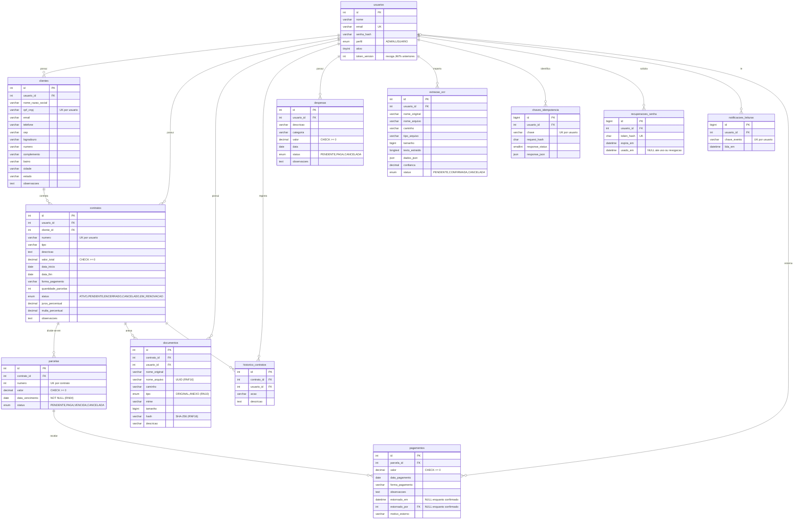

# ContractFlow — DER (Diagrama Entidade-Relacionamento)

> Gerado a partir de `api/database/schema.sql` (MySQL 8+). Todas as FKs usam
> `ON DELETE RESTRICT` (RN11: nada financeiro importante é removido em cascata).
> Isolamento por usuário (RNF04): `clientes.usuario_id` e `contratos.usuario_id`
> (desnormalizado de propósito para filtrar tudo pelo dono sem JOIN extra);
> parcelas, pagamentos e documentos são alcançados pela cadeia
> contrato → cliente → usuário.
>
> Este DER descreve a estrutura implementada. O diagrama externo no Miro
> deve acompanhar as migrações versionadas abaixo.

## Cardinalidades (leitura)

| Relacionamento | Cardinalidade | Regra |
|---|---|---|
| usuarios → clientes | 1:N | Um usuário possui N clientes; cliente pertence a 1 usuário (RNF04) |
| usuarios → contratos | 1:N | Desnormalizado para filtro direto por dono (RNF04) |
| clientes → contratos | 1:N | Um cliente tem vários contratos (RN01); contrato exige 1 cliente (RN02) |
| contratos → parcelas | 1:N | Geradas automaticamente na criação (RF14/RF15) |
| parcelas → pagamentos | 1:N | Pagamento pertence a 1 parcela válida (RN06) |
| contratos → documentos | 1:N | ORIGINAL + ANEXOs (RN10, RF09/RF41) |
| contratos → historico_contratos | 1:N | Eventos de criação/alteração/pagamento/status (RF36) |
| usuarios → despesas | 1:N | CRUD implementado na Sprint 2 (RF25) |
| usuarios → extracao_ocr | 1:N | Sugestões pendentes/revisadas antes da confirmação (RN09) |
| usuarios → chaves_idempotencia | 1:N | Uma chave identifica uma operação por usuário e preserva a resposta confirmada |
| usuarios → recuperacoes_senha | 1:N | Somente o hash do token temporário é armazenado |
| usuarios → notificacoes_leituras | 1:N | Leitura por origem/tipo/data do evento |
| usuarios → pagamentos (estornado_por) | 0..1:N | Responsável pelo estorno; campos nulos enquanto confirmado |

## Índices (desempenho — RNF09)

FKs e campos de filtro possuem índices `idx_*`: `usuario_id` (todas as tabelas),
`cliente_id`, `status`, `data_vencimento`, `data_pagamento`, `contrato_id`,
`parcela_id`, `data`. Unicidades: `usuarios.email`, `(usuario_id, cpf_cnpj)`,
`(usuario_id, numero)` em contratos, `(contrato_id, numero)` em parcelas.

## Migrações e renovação (Sprint 2)

`usuarios.token_version` é adicionado pela migração 001 em bancos existentes.
O executor registra versão/checksum/aplicação em `schema_migrations`, tabela de
infraestrutura sem relações com entidades financeiras. `npm start`/`npm run dev`
aplicam as migrações; não remover banco/tabelas para atualizar.

Renovação cria novo contrato do mesmo cliente e mantém os anteriores. A relação
entre IDs é registrada nos dois históricos (`RENOVADO`/`ORIGEM_RENOVACAO`), sem
nova FK. Pagamentos/documentos antigos continuam vinculados à sua origem.

As migrações 002–004 adicionam as tabelas de idempotência, recuperação e leitura.
A migração 005 acrescenta metadados de estorno a `pagamentos`, com FK do autor e
CHECK exigindo metadados completos. O lançamento original permanece armazenado;
consultas de saldo somam apenas pagamentos com `estornado_em IS NULL`.
